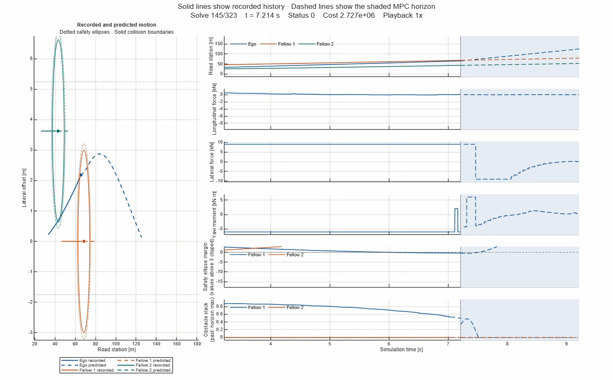

# Real-Time NMPC for Vehicle Collision Avoidance

An acados controller running in **dSPACE VEOS** commands steering and four-wheel drive/brake torques in **ASM Traffic**. The project connects nonlinear predictive control, tire-friction-limited allocation, and recorded-data analysis so individual solver decisions can be traced to the vehicle response.

**2.0 s prediction horizon** · **50 ms controller period** · **41 state nodes** · **4 independently allocated wheel torque commands**

[Demo](#veos-demonstration) · [System](#closed-loop-system) · [Equations](#control-formulation) · [Results](#recorded-results) · [Reproduce](#reproduce-the-workflow)

## VEOS demonstration

**[Watch or download the MP4](docs/figures/veos/prediction-horizon.mp4)**. The animation advances one recorded solve at a time. The road view shows the traveled path and the changing prediction. The stacked time plots show recorded history and a shaded two-second forecast with solver status, cost, and obstacle slack.

## Closed-loop system

~~~mermaid
flowchart LR
    R["Uploaded road scenario MATLAB .mat"] --> H["Horizon preparation"]
    P["ASM Traffic plant"] -->|"Ego state and fellow traffic"| H
    H -->|"41 nodes of stage data"| M["acados NMPC Generated S-function"]
    M -->|"Fx, Fy, Mz"| A["Steering and torque allocation"]
    P -->|"Wheel angles, tire forces, normal loads, friction"| A
    A -->|"Steering and four drive/brake commands"| P
    M --> D["ControlDesk recording"]
    P --> D
    D --> V["MATLAB converter Plots and prediction replay"]
~~~

The ASM interface exposes 15 spatial curvature-preview entries. The uploaded scenario supplies the road reference for every NMPC node, using the selected family's curvature, reference speed, and road bounds. ASM provides live ego station and speed, lateral motion, and fellow positions and velocities.

For the saved VEOS test model, the horizon advances the ego station from the warm-start speed error and the fellow stations from their current ASM speeds:

$$
s_{k+1}=s_k+T_s\big(v_r+v_{\mathrm{err},k}^{\mathrm{warm}}\big),
\qquad s_{i,k}=s_{i,0}+kT_s v_{i,0}.
$$

## Control formulation

### Prediction model

The state and body-frame input are

$$
x=[e,\ \psi,\ v_{\mathrm{err}},\ v_y,\ r]^\top,\qquad
u=[F_x,\ F_y,\ M_z]^\top .
$$

Here $e$ and $\psi$ are the lateral and heading tracking errors, $v_{\mathrm{err}}$ is the along-path speed error, $v_y$ is body lateral speed, and $r$ is yaw rate. Let $\beta$ be the reference sideslip correction, $\kappa$ the road curvature, and primes denote derivatives with respect to road station. The model uses $\theta=\psi+\beta$ and $\dot{s}=v_r+v_{\mathrm{err}}$.

$$
\begin{aligned}
\dot e &= v_x\sin\theta+v_y\cos\theta,\\
\dot\psi &= r-(\kappa+\beta')\dot{s},\\
\dot v_{\mathrm{err}} &= \frac{F_x\cos\theta-F_y\sin\theta}{m}
                         +\kappa\dot{s}\dot e-v_r'\dot{s},\\
\dot v_y &= F_y/m-v_xr,\\
\dot r &= M_z/I_z .
\end{aligned}
$$

The solver uses RK4 integration with $T_s=0.05$ s and $N=40$ shooting intervals. At each solve it fixes $x_0$ to the measured state. Implementation and feedforward terms are in [vehicle_rhs.m](src/+ecu/+model/vehicle_rhs.m) and [feedforward.m](src/+ecu/+control/feedforward.m).

### Objective and constraints

The objective combines tracking error, deviation from the road feedforward input $u_{\mathrm{ff},k}$, and the cost of constraint violations. Define $\Delta u_k=u_k-u_{\mathrm{ff},k}$.

The feedforward term uses the road and reference-speed profile. With $\chi'=\kappa+\beta'$ and $\chi''=\kappa'+\beta''$:

$$
\begin{aligned}
F_{x,\mathrm{ff}} &= m\big(\cos\beta\,v_r'v_r+\sin\beta\,\kappa v_r^2\big),\\
F_{y,\mathrm{ff}} &= m\big(\cos\beta\,\kappa v_r^2-\sin\beta\,v_r'v_r\big),\\
M_{z,\mathrm{ff}} &= I_z\big(\chi''v_r^2+\chi'v_r'v_r\big).
\end{aligned}
$$

$$
\begin{aligned}
J={}&\frac12 x_N^\top Q_Nx_N+
\sum_{k=0}^{N-1}
\left[\frac12 x_k^\top Qx_k+\frac12\Delta u_k^\top R\Delta u_k+
\sum_{j=1}^{5}\big(\phi(\sigma^L_{j,k})+\phi(\sigma^U_{j,k})\big)\right],\\
\phi(\sigma)={}&z\sigma+\frac12 Z\sigma^2,\qquad \sigma\ge0.
\end{aligned}
$$

| Setting | Configuration |
|---|---|
| State weights | $Q=\operatorname{diag}(20,50,2,0.1,0.1)$ and $Q_N=10Q$ |
| Input weights | $R=\operatorname{diag}(10^{-6},10^{-6},10^{-7})$ |
| Hard input bounds | $F_x\in[-9000,4500]$ N, $F_y\in[-9000,9000]$ N, $M_z\in[-6000,6000]$ N·m |
| Soft constraints | Lateral velocity, yaw rate, road bounds, and one safety margin per fellow |
| Slack weights in the checked solver build | $z=Z=10^6$. Earlier recordings can use different weights. |

The stability bounds are $|v_y|\le0.02\mu g v_x$ and $|r|\le0.85\mu g/v_x$ before slack. The road constraint uses $e_{\min}\le e\le e_{\max}$ before slack.

For each fellow $i$, the implemented quadratic safety margin and its softened lower bound are

$$
h_{i,k}=\left(\frac{e_k-e_{i,k}}{a_i}\right)^2+
\left(\frac{s_k-s_{i,k}}{b_i}\right)^2-1,\qquad
h_{i,k}+\sigma^L_{i,k}\ge0 .
$$

The boundary is $h=0$ and negative values require slack. The current scenario defaults are **[3.20, 6.71] m** for safety and **[3.00, 5.75] m** for the collision check, in lateral–longitudinal order. VEOS loads the active safety axes from the saved scenario instance. The inner collision envelope is a diagnostic and scenario termination check. The solver enforces the outer safety envelope with slack. The [Family 1 design note](docs/FAMILY1_OBSTACLE_ENVELOPES.md) describes the proposed fourth-power footprint fit and the position references it requires. Solver settings are in [controller_config.m](config/controller_config.m) and [ocp_nmpc_setup.m](src/+ecu/+control/ocp_nmpc_setup.m).

### Steering conversion

The adapter uses lateral force and measured motion to form an equivalent front road-wheel request. With $C_f=2C_y$, blend speed $v_b=1$ m/s and steering ratio $i_{\mathrm{SW}}$:

$$
\begin{aligned}
\delta_{\mathrm{raw}}&=\frac{F_y^{\mathrm{cmd}}}{C_f}
 +(v_y+l_f r)\frac{v_x}{v_x^2+v_b^2},\\
\delta_f&=\operatorname{clip}(\delta_{\mathrm{raw}},-\pi/6,\pi/6),\\
\theta_{\mathrm{SW,cmd}}[\mathrm{deg}]&=i_{\mathrm{SW}}\delta_f\,180/\pi .
\end{aligned}
$$

The road-wheel command is limited to ±30°. The current NMPC formulation has no steering-rate constraint.

### Friction-limited four-wheel torque allocation

The allocator solves for the longitudinal tire-force adjustments $\Delta\mathbf f$ around an equal-force baseline $\mathbf f_0$. It uses the two measured front wheel angles and zero rear steer. For wheel $i$, let $c_i=\cos\delta_i$, $s_i=\sin\delta_i$, and $(x_i,y_i)$ be its position relative to the vehicle center of gravity. Each column maps a wheel force into body $F_x$, $F_y$, and $M_z$.

$$
A_i=\begin{bmatrix}c_i\\s_i\\x_i s_i-y_i c_i\end{bmatrix},
\qquad B_i=\begin{bmatrix}-s_i\\c_i\\x_i c_i+y_i s_i\end{bmatrix}.
$$

The baseline subtracts the forward contribution of the supplied lateral tire forces $\mathbf f_y$ and accounts for the steering projection. Write $\mathbf w_{\mathrm{cmd}}=[F_x^{\mathrm{cmd}},F_y^{\mathrm{cmd}},M_z^{\mathrm{cmd}}]^\top$ and $S=\operatorname{diag}(1,1,1/(t/2))$ for track width $t$.

$$
f_{0,i}=\frac{F_x^{\mathrm{cmd}}-(B\mathbf f_y)_1}{\sum_j c_j},
\qquad
\widehat{\mathbf w}=A(\mathbf f_0+\Delta\mathbf f)+B\mathbf f_y .
$$

$$
\min_{\Delta\mathbf f}\ 
\left\|S(\widehat{\mathbf w}-\mathbf w_{\mathrm{cmd}})\right\|_2^2
+10^{-6}\|\Delta\mathbf f\|_2^2 .
$$

The remaining grip at each wheel determines the bounds supplied to the active-set least-squares solve. Total wheel torque uses the baseline plus the optimized adjustment.

$$
\begin{aligned}
F_{i,\max}&=\sqrt{\max\!\left(0,(\mu_iF_{z,i})^2-F_{y,i}^2\right)},\\
-F_{i,\max}-f_{0,i}&\le\Delta f_i\le F_{i,\max}-f_{0,i},\\
T_i&=R_w(f_{0,i}+\Delta f_i),\\
T_{\mathrm{drive},i}&=\max(T_i,0),\qquad
T_{\mathrm{brake},i}=\max(-T_i,0).
\end{aligned}
$$

[Allocator source](scripts/integration/asm/adapters/allocate_4wd_torque.m)

## Recorded results

The recording converter preserves signal names, timestamps and metadata. It aligns the logged warm-start trajectories with the original solver stage numbering and verifies the prepared horizon against the solver input. This makes it possible to inspect a measured maneuver and the forecasts that preceded it.

| Evidence | Observation |
|---|---|
| Recording 3 | Verified 4,308 channels and aligned 386 solver updates. At 2.279 s, Fellow 1's minimum predicted safety margin was −0.3948 with 0.3948 peak lower slack. |
| Recording 6 | At 9.141 s, the ego reference point entered the plotted quadratic collision envelope. Its collision margin was −0.196 and the safety constraint used 0.339 slack at stage zero. The solver returned status 0. |

The envelope checks evaluate signals in road coordinates. Physical overlap requires comparing the two oriented vehicle boxes at the same instant. A hard inner collision constraint and verified box-center references remain follow-up work.

## Reproduce the workflow

1. Open [ECU_RealTime_Control_Performance.prj](ECU_RealTime_Control_Performance.prj) in MATLAB. Set the required acados and CasADi paths in a local copy of [config/local.example.json](config/local.example.json).
2. Run the [Windows VEOS controller build](docs/WINDOWS_VEOS_WORKFLOW.md) with MATLAB R2026a and the dSPACE HostPC64/GCC toolchain. `build_veos_windows` generates and compiles the S-function and prepares dependency registration.
3. Initialize the ASM Traffic model, generate the VEOS application, and record the solver and vehicle signals in ControlDesk. This step requires a compatible dSPACE installation and the ASM, ModelDesk, and ControlDesk project files.
4. Run [convert_veos_recording.m](scripts/convert_veos_recording.m) on the exported MAT file and replay it with [animate_prediction_horizon.m](src/+ecu/+veos_analysis/prediction_horizon/animate_prediction_horizon.m). The replay supports solve stepping, a configurable time window, and MP4 export.

| Project area | Where to start |
|---|---|
| Solver formulation and generated S-function | [Controller setup](docs/CONTROLLER.md) |
| ASM measurements and actuator commands | [Simulink integration](docs/SIMULINK_GUIDE.md) |
| Scenario and road reference data | [Scenario setup](docs/SCENARIOS.md) |
| Build and dependency registration | [Windows VEOS workflow](docs/WINDOWS_VEOS_WORKFLOW.md) |
| Recording, plots, and replay | [VEOS analysis package](src/+ecu/+veos_analysis) |
